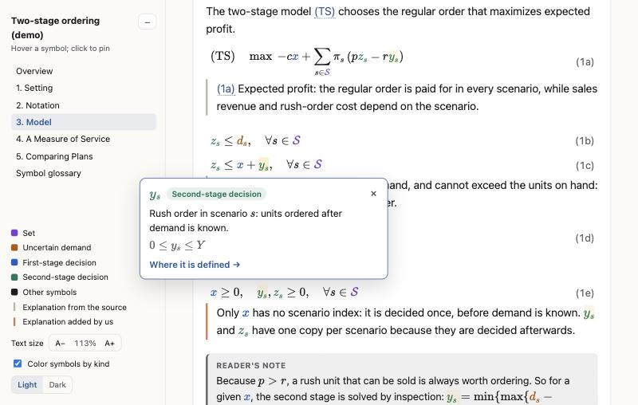

# hovermath

An agent skill that turns a math-heavy document into one interactive HTML page, so that you never have to
scroll back to a symbol table while reading a line of math.



Give your agent a paper, a PDF, a Markdown or LaTeX file, an optimization model, or a model you have just
worked out together in the chat, and ask for a hovermath page. You get a single HTML file in which:

- **every symbol shows its definition on hover**, with its kind and domain, and a click pins the tooltip;
- the same goes for **any name the author defines**, such as a named index or a case label;
- **equation numbers in the text preview the equation** on hover and jump to it on a click;
- **each group of equations is followed by its explanation**, instead of a full model followed by a wall of text;
- symbols are **colored by kind** (for example first-stage decisions, second-stage decisions, uncertain
  quantities), with a legend;
- a contents panel, text-size control, color switch and light/dark switch are always at hand. The page also works at phone width.

It was made for optimization and modeling papers, where a page of constraints can involve dozens of symbols,
but it works for any text with defined notation.

## Quick start

**1. Install.** Paste this to your agent:

```text
Install this skill: https://github.com/zhiyuanfx/hovermath
```

**2. Ask for a page.** For example:

```text
Make a hovermath page for paper.pdf.
```

```text
Turn model.md into a hovermath page and explain every group of constraints.
```

```text
Write up the model we just discussed as a hovermath page.
```

If your agent has no skills feature, tell it to read `SKILL.md` in this repository and follow it.

## Try the demo

**[Open the live demo](https://zhiyuanfx.github.io/hovermath/examples/two-stage-ordering.html)**: a toy
two-stage ordering model written for this repository. Hover a symbol, or an equation number such as (1c).

The same page is in the repository as [`examples/two-stage-ordering.html`](examples/two-stage-ordering.html).

## Defaults and options

| | Default | Alternative |
| --- | --- | --- |
| **Figures** | Embedded in the page. The result is one file that you can email or put anywhere. Embedding adds about a third to the size of the image files; a paper with ten figures is typically 1 to 2 MB. | A `figures/` folder next to the page. The HTML file stays small, and the folder has to travel with it. Ask for "figures in a folder", or run `python3 scripts/embed_figures.py page.html --clear`. |
| **Math renderer** | [KaTeX](https://katex.org) is loaded from a public CDN when the page opens, so viewing needs an internet connection. | An offline copy with KaTeX inside the file, about 0.65 MB larger. Ask for "an offline copy", or run `python3 scripts/make_offline.py page.html`. The script downloads KaTeX once, unless a copy is in `assets/katex/`. |

Other things you can ask for: a condensed or paraphrased version instead of the source's wording, more or
fewer added explanations, different symbol kinds and colors, or only part of a document.

If the source is someone else's published work, remember that the page reproduces its text before you post
the page publicly.

## What is in the repository

```
SKILL.md                 instructions for the agent
references/format.md     the content format of a page
assets/template.html     the page engine with a placeholder document
scripts/
  check_page.py          checks a page's content without a browser
  crop_figure.py         cuts figures out of a PDF (needs PyMuPDF)
  embed_figures.py       puts the figures inside the page
  make_offline.py        makes a copy of a page that works offline
examples/                the demo page and its figure
docs/screenshot.jpg      the picture above
LICENSE                  MIT License
```

A page is the template with one block of content replaced: a header, the kinds of symbols, a symbol table
and the sections. Everything else in the file is the engine, which is plain HTML, CSS and JavaScript with no
build step. To change a page by hand, edit that block; [`references/format.md`](references/format.md)
describes it.

## Requirements

- A browser to view pages. No server is needed; open the file.
- Python 3 for the scripts. Only `crop_figure.py` needs a package: `pip install pymupdf`.

## Notes and limits

- The agent types the math from the source. For PDFs, check the equations of anything you rely on; the page
  lists formulas that fail to render, but it cannot know that a subscript was misread.
- Math is rendered with KaTeX, which covers most of LaTeX math but not all of it.
- Hover needs a pointer. On a touch screen, tap a symbol to pin its definition.

## License and credits

hovermath is released under the [MIT License](LICENSE).

Math rendering by [KaTeX](https://katex.org), also under the MIT License.
